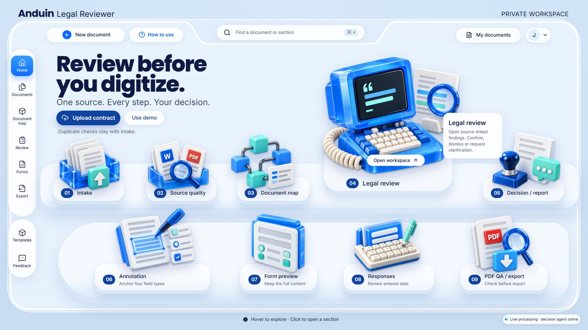
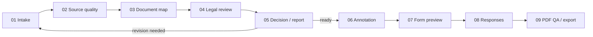

# Anduin Legal Reviewer

**Review contracts before you digitize: source-linked findings, human decisions and verified exports.**

My entry for **The Legal Reviewer** challenge (Legal track) of Anduin's Cybernetics hackathon.

**[Live application](https://anduin-legal-reviewer.vercel.app)** · **[Introduction video (89 s)](demo/video/anduin-legal-reviewer-intro.mp4)** · **[Test reports](evals/results/)** · **[Judge reading guide](docs/judging/README.md)** · **[Build logs](progress/build-log/)**

---

## The app in one minute

https://github.com/user-attachments/assets/48a10deb-1db1-4e8d-8055-efa1b6e6cafb

*Introduction video (89 s): test results first, then the workflow in six short chapters. [Full-resolution 1080p file](demo/video/anduin-legal-reviewer-intro.mp4).*

Before a fund document is turned into an online form, someone has to read it for typos, broken references, conflicting clauses and unclear terms. Found late, these cause rework and questions to outside counsel. Anduin Legal Reviewer is a **pre-digitization gate** for that review:

1. **Upload** a Word or PDF file. A Word file is converted with Microsoft Word and compared word for word with its PDF, so the review starts from verified text.
2. **Review.** Rules and an AI reviewer flag problems. Each finding quotes the exact passage and page; anything that cannot be quoted from the source is rejected.
3. **Decide.** The reviewer confirms, dismisses with a reason, or writes a question for counsel. The report states one outcome and the next step.
4. **Digitize.** Fields are anchored with four types (paragraph, text box, radio box, checkbox), shown as a form that keeps the full contract text, and answered.
5. **Export.** The filled PDF is read back and checked (content, mapping, values, clipped answers) before the final export is allowed.

Decisions are remembered, so later reviews in the same workspace learn from them.



---

## How I tested it, and the results

I wrote synthetic fund documents and **planted known problems** in each one (typos, missing sections, conflicting numbers, vague terms, undefined terms), plus **traps**: correct text that a careless checker would flag. Every file's planted problems and traps are listed in [`expected.json`](data/demo-contracts/expected.json). Then I tested at four levels:

| Level | How | Result |
| --- | --- | --- |
| Unit tests | `npm test`: rules, evidence gate, annotation QA, form export and import, source checks, revised PDF | 18 passed, 1 manual test skipped |
| Rules alone, offline | `npx vitest run --dir evals`: no AI, no network | 53/53 rule-detectable problems found; 94/94 fabricated quotes rejected |
| Full pipeline on the live app | `scripts/e2e-contracts.mjs` uploads all 15 files to production and runs every step to a confirmed final PDF | **54/57 planted problems found (95%)**; 129/129 findings quote the source verbatim |
| Hard cases | Prompt injection, two-column layout, bilingual text, tables, a scanned page, a corrupted PDF | Injection ignored (4/4 found); scan and corrupted file reported as unreadable, never crashed |
| Manual check | I read all 129 findings | **34 were wrong**: 24 from the two-column file (text merged across columns), 8 spelling flags on British, legal or bilingual wording, 2 needless wording questions |

**Speed.** The 38-page, 17,146-word booklet goes from upload to a finished review in 3–4.5 minutes; reading it once takes about 72 minutes at an average reading rate. No timed human study was run, so I don't claim a speed-up factor.

**Known limits:** two-column PDFs are extracted poorly; scanned pages are reported, not read (no OCR); one 38-page Word run hit the 300-second server limit and needed a retry.

Full method and per-file results: [scenario test report (15 files)](evals/results/2026-10-16-scenario-test-report.md) and [judge test report (8 files)](evals/results/2026-10-16-judge-test-report.md). All documents are synthetic; this is not a benchmark of real contracts.

---

## Contents

| # | Section | What you will find |
| --- | --- | --- |
| 1 | [About me](#about-me) | Who built this, background, portfolio, LinkedIn, CV summary |
| 2 | [My take on the challenge](#my-take-on-the-challenge) | The brief, how I interpreted it, and the principles behind the product |
| 3 | [Try it in two minutes](#try-it-in-two-minutes) | A short path through the live app for judges |
| 4 | [What the application does](#what-the-application-does) | The nine workspaces and the problem each one solves |
| 5 | [How findings are produced](#how-findings-are-produced) | Rules, semantic reviewer, evidence validator, decision agent |
| 6 | [Architecture](#architecture) | Browser, Vercel, Supabase and the worker; project and pipeline maps |
| 7 | [Technology and languages](#technology-and-languages) | Stack, programming languages, contract languages supported |
| 8 | [Testing and evidence](#testing-and-evidence) | Every check, with its latest recorded result |
| 9 | [Security and privacy](#security-and-privacy) | How uploads, sessions, untrusted Word files and contract text are handled |
| 10 | [Status and limitations](#status-and-limitations) | What is verified, what is not, and why |
| 11 | [Running locally](#running-locally) | App, worker and checks |
| 12 | [Repository map and documents](#repository-map-and-documents) | Where everything lives and what to read next |
| 13 | [How this was built](#how-this-was-built) | Development process, commits and documentation discipline |

---

## About me

**Pham The Quan (Jayson)**, based in Ho Chi Minh City, Vietnam.

[Portfolio](https://jayson-portfolio-sigma.vercel.app/) · [LinkedIn](https://www.linkedin.com/in/ptquan2004/) · [GitHub](https://github.com/ptquanwork-cmyk)

I work on operations and business analysis, and I build tech and AI workflows. My background is in Finance. I turn business needs into structured inputs, dashboards and usable processes: I build with AI assistance, check the outputs carefully, and hand over documented work.

**CV summary**

| Area | Highlights |
| --- | --- |
| Education | Bachelor of Finance, University of Economics Ho Chi Minh City (UEH), 2022–2026. Academic requirements completed; graduation ceremony expected March 2027 |
| Steersman Brewery (client engagement, Jul 2026 – present) | Sole service provider. Configured an Odoo workspace across Sales, Purchase, Inventory and Finance/Accounting. Built a management dashboard, an Apps Script reporting interface and a financial-health model (about 40 ratios, break-even, 36-month forecasts). Wrote the scope, milestones and acceptance terms, and ran UAT and handover |
| BLOCK71 Vietnam / NUS Enterprise (Venture Analyst Intern, Nov 2025 – Jun 2026) | Program team: tracking systems for volunteers, vendors and performers; runsheets and operations files for UniVentures, Demo Day and ELab; research and 3D venue maps; AI workshop materials |
| QuickFish (Frontend & Agent OS Prompt Engineering supporter, May 2026 – present) | Interfaces and user flows for an AI career-guidance startup; agent role instructions, output formats, review checklists and handoff notes |
| Finance and data | Vietcap internship (Mar–Jul 2025, equity research practice); Excel/VBA models for 30 listed companies leading a ten-member team; ESG study data checks across 3,168 companies in 20 Asian countries; DCF, WACC and Monte Carlo valuation work |
| Personal AI systems | Obsidian capture-and-report workflow (JayVault), an agent-office prototype, a local agentic operating system with scheduled reports and review/handoff routines |
| Credentials | IBM Business Analyst Professional Certificate · IELTS 7.0 (Speaking 8.0) · Vietcap Talented Student Internship certificate · CFA Level I–III preparation pathway (ongoing) |
| Languages | Vietnamese (native), English |

The full CV and case studies are on the [portfolio](https://jayson-portfolio-sigma.vercel.app/).

**Why this challenge.** Anduin's work sits where my background meets: fund documents that investors fill in (Finance), digitization work that depends on clean inputs and clear handoffs (operations), and AI that has to be checked before anyone relies on it. This project brings those three together.

---

## My take on the challenge

**The brief, paraphrased** ([challenge brief](docs/challenge/brief.md)). A company that digitizes complex legal agreements must review incoming contracts before starting work. If typos, unresolved references, conflicting clauses and unclear terms are found late, they cause rework, and they often need clarification from external counsel. The challenge leaves the product interpretation to the builder.

**My interpretation.** The reviewer does not need another chatbot. They need a **pre-digitization gate** that:

1. **Proves the source first.** Word files are converted and compared with the PDF, and font substitution or lost text is flagged before anything is reviewed.
2. **Finds problems with evidence.** Every finding quotes the exact source text and its page. Anything without a matching quote is rejected and listed as a limitation.
3. **Keeps the human in charge.** Confirm, dismiss with a reason, or ask counsel. A confirmed issue is not the same as a resolved one; resolution is proposed only when a new version no longer contains the problem, and the reviewer confirms it.
4. **Carries the work through to the outcome Anduin cares about.** Annotation (exactly four field types), a form that keeps the full contract text, version-bound investor answers, and a filled PDF that is re-read and checked before any final export.
5. **Remembers.** Decisions are append-only, approved field structures become templates, and selected decisions guide later reviews in the same workspace.

The demo contracts are synthetic **fund subscription documents**: subscription agreements, investor questionnaires, side letters, long subscription booklets, a Vietnamese agreement and a fillable PDF. They are the kind of documents investors fill in for funds.

**Principles applied throughout:** preserve the original and its version identity; tie every claim to a source location; show uncertainty instead of hiding it; never present a score as a probability of correctness; keep contract text strictly as data, never as instructions.

---

## Try it in two minutes

1. Open the **[live application](https://anduin-legal-reviewer.vercel.app)**. It is designed for desktop browsers.
2. Hover over the 3D stations, then click **Use demo**. A synthetic services agreement is uploaded and processed live (Received → Duplicate lookup → Source checks → Decision agent routing → Legal review → Field detection).
3. **Source quality:** the Word original next to the converted PDF, with any font substitution.
4. **Legal review:** findings with exact quotes. Try Confirm, Dismiss (a reason is required) or Needs clarification.
5. **Decision / report:** the outcome, questions for counsel, and the review report PDF.
6. **Annotation → Form preview → Responses → PDF QA / export:** approve fields, answer them, and watch QA catch a clipped answer before the final export is allowed.

More synthetic documents to upload yourself are in [`data/demo-contracts/`](data/demo-contracts/README.md). Every visitor gets a private anonymous workspace. Please don't upload real confidential contracts to a hackathon build.

> The worker (decision agent, Word conversion, semantic reviewer) runs on my laptop behind a tunnel. When the laptop is off, the app says **decision agent offline**: the rules, evidence checks, reports and forms still work, and Word conversion and semantic review resume when the worker is back.

---

## What the application does

One page: a 3D workflow hub opens nine workspaces. Its stations are the approved high-resolution 3D renders; real-time three.js versions modelled in Blender are available with `?three`. Clicking a station flies its object into the workspace header.

| # | Workspace | What actually happens |
| --- | --- | --- |
| 01 | Intake | Upload to private storage, SHA-256 identity (exact duplicates reopen the earlier record), live job steps, related-version candidates by content similarity, block diff and "treat as new version" |
| 02 | Source quality | Word original rendered beside the PDF that Microsoft Word itself produced; text compared word for word, automatic re-conversion if Word fails or text differs; font-substitution detection (declared Word fonts vs fonts embedded in the PDF); page coverage; manual-comparison gate only when text really differs |
| 03 | Document map | Outline from numbered headings (English and Vietnamese), parsed references/definitions, proposed conflicts as dashed edges, page map, source drawer |
| 04 | Legal review | Typos, missing references, contradictions, ambiguities and undefined terms with exact quotes and page anchors; confirm / dismiss with reason / request clarification; separated confidence signals |
| 05 | Decision / report | Outcome (ready, needs clarification, revision needed, approved with exceptions, blocked by source quality), questions for counsel, review report PDF, **Create revised PDF**: write corrections for confirmed issues (spelling fixes pre-filled), then download the revised PDF or upload it as the next version; v1→v2 comparison where a missing finding is only *proposed* resolved until the reviewer confirms |
| 06 | Annotation | Exactly four types (paragraph, text box, radio box, checkbox); detection from layout and AcroForm fields, double-checked by the decision agent; drag/resize/draw editor; content-based transfer between versions; QA gate |
| 07 | Form preview | Full original text in order with controls; unmapped blocks block responses; plain-language help kept separate from contract text; **Export HTML form**: a self-contained, branded page anyone can fill in a browser, with progress, a contents list and a jump to the next field to fill |
| 08 | Responses | Version-bound answers with autosave and validation; **Import answers** from the exported form; draft PDF only when required answers are present |
| 09 | PDF QA / export | Answers written into the PDF at annotation geometry, then the output is re-read: content coverage, field mapping, answer values, page render (e.g. *answer clipped*). Final export only after QA passes and the reviewer confirms |

Every screen has a **How to use** guide in the top bar (numbered steps naming the buttons to click), and a **full-screen** button next to it hides the header and stretches the whole working area to fill the screen (PDF pages render larger and sharper). Decisions can also be made on the Decision / report screen, which states the next step that blocks digitization.

**Templates** (approved field structure, no answers) and **Feedback** (decision history; selected decisions guide later semantic reviews in the workspace) are management pages.

---

## How findings are produced

1. **Deterministic rules** (`src/review/checks.ts`): numeric contradictions between near-identical obligations, references to sections/exhibits/annexes that do not exist (including *Điều/Khoản/Phụ lục*), vague obligation terms, capitalised terms without definitions, and spelling (Hunspell dictionaries plus a high-precision list).
2. **Semantic reviewer** (`src/review/semantic.ts`, prompt [`contract-review-v2`](prompts/review/contract-review-v2.md), strict JSON schema): contradictions, ambiguities and undefined terms. Contract text is sent as data, and the reviewer may return nothing. Engine: the OpenAI Responses API when `OPENAI_API_KEY` is configured and funded; otherwise, and as an automatic fallback, the Codex CLI running locked down in the worker (no tools, shell, browser or web search).
3. **Evidence validator** (`src/review/validate.ts`): every quote must match the extracted source text, contradictions need two matched passages, and duplicates are merged. Unsupported candidates are rejected and listed as limitations.
4. **Decision agent** ([Laya](https://github.com/NandhaKishorM/laya), Apache-2.0) in the worker: routes steps (document type, fillable fields, need for semantic review), orders findings (needs counsel, impact) and double-checks annotation types. Its `answer_confidence` is shown as **not calibrated**.

No score is presented as a probability of correctness, and no confirmation is presented as a resolution.

---

## Architecture



```text
Browser (Next.js single page, 3D station renders, pdf.js viewer)
  │  Supabase anonymous session (RLS: owner = auth.uid()), direct upload to private storage
  ▼
Vercel functions (Next.js route handlers; pipeline runs after the response, job steps via Realtime)
  ├─ src/review    extraction, rules, semantic adapter, evidence validator, report
  ├─ src/digitize  field detection, annotation QA, form model, PDF fill + QA
  └─ worker (owner's machine behind a Cloudflare quick tunnel; URL published to Supabase)
        /jobs/convert   Word → PDF with Microsoft Word (or LibreOffice in the Docker image), after a strict sanitiser
        /jobs/decide    Laya typed decisions, batched, on one model thread
        /jobs/semantic  locked-down Codex CLI review, per-user and global quotas
        Access: requests carry the caller's Supabase session, verified with Supabase Auth
```

Pipeline order: source checks → duplicate lookup → decision-agent routing **in parallel with** the semantic review → rules + validator → review and field detection side by side. When the worker is offline, the application still reviews Word text (without page geometry) and says so on every affected screen.

**Where data lives:** originals and generated PDFs are in private Supabase Storage buckets (`sources`, `exports`), in a folder per user. Extracted blocks, findings, append-only decisions, annotations, answers, templates and job state are in Postgres tables with row-level security.

Details: [architecture and workflow map](docs/architecture/overview.md) (each step, the system behind it, the processing pipeline, speed, accuracy, memory and folder categories).

---

## Technology and languages

| Layer | Technology |
| --- | --- |
| Front end | Next.js 16 (App Router), React 19, TypeScript, Tailwind CSS 4, Motion, three.js with react-three-fiber/drei, pdf.js, React Flow + dagre |
| Documents | mammoth (Word text/structure), pdf-lib + fontkit (fill, AcroForm, report PDF), nspell with English/Vietnamese Hunspell dictionaries, diff |
| Back end | Vercel functions (Node 24, Fluid compute), Supabase Postgres + RLS, Storage, Realtime, anonymous auth |
| Worker | Python 3.11, FastAPI, Microsoft Word automation (LibreOffice in Docker), Laya decision agent (PyTorch), Codex CLI, Cloudflare quick tunnel |
| 3D | Blender (scripted modules, `design/blender/build_modules.py`), Draco-compressed GLB, live PBR rendering; PNG stills as fallback |
| Quality | Vitest, Python test scripts, Node end-to-end scripts with machine-readable expected results |

**Programming languages in this repository** (tracked source, lines): TypeScript/TSX about 8,000 · Python about 1,650 · JavaScript (scripts) about 870 · SQL (migrations) about 300 · CSS about 250.

**Contract languages:** English and Vietnamese. Headings, references (*Điều, Khoản, Mục, Chương, Phụ lục*), vague terms and spelling are handled for both. The semantic reviewer answers in the document's language, and the decision agent switches to its multilingual model for Vietnamese.

---

## Testing and evidence

| Check | What it covers | Latest recorded result |
| --- | --- | --- |
| `npm test` (Vitest, `tests/review.test.ts`, `tests/revise.test.ts`) | Rules on long boilerplate, all four challenge categories, a clean sample with zero findings, Vietnamese references, quote validation, single-passage contradictions rejected, embedded instructions treated as text, the four annotation types, annotation QA, AcroForm import, exported HTML form escaping and answer import, Word-to-PDF source-check severity, revised-PDF quote matching and re-reading | 18 passed, 1 manual test skipped (19 Oct 2026) |
| `npx tsc --noEmit`, `next build` | Types and production build | Clean (16 Oct 2026) |
| `worker/test_sanitize.py` | Word sanitiser: macros, DTDs, external links, remote fields, embedded objects, altChunk, SVG and more refused | Passed (16 Oct 2026) |
| `worker/test_semantic_quota.py` | Semantic quotas, job caps, job privacy and accounting | Passed (16 Oct 2026) |
| `scripts/e2e-contracts.mjs` | All eight synthetic contracts end to end against a running app: upload, processing, report, fill, QA and confirmed final PDF, scored against [`expected.json`](data/demo-contracts/expected.json) | Production, 16 Oct 2026: **35/36 planted problems found (97%), 0/11 false-alarm traps hit, 80/80 findings grounded verbatim**; 8/8 confirmed final PDFs (6 on the first attempt, 2 after one retry). Same accuracy on 15 Oct. [Judge test report](evals/results/2026-10-16-judge-test-report.md) |
| Scenario run, 15 files (`scripts/e2e-contracts.mjs`) | Seven added scenarios: clean control, tables and a landscape page, prompt injection, two-column layout, bilingual text, image-only scan, corrupted PDF | Production, 16 Oct 2026: **54/57 planted problems (95%)**; 34 of 129 findings wrong, 24 of them from two-column extraction; injection ignored; scan and corrupted file reported, not reviewed. [Scenario test report](evals/results/2026-10-16-scenario-test-report.md) |
| `evals/rules-offline.test.ts` (`npx vitest run --dir evals`) | Deterministic layer without AI or network: recall on planted problems, false alarms, stage timings, grounding of every quote, fabricated quotes against the evidence gate, labeled cases | 16 Oct 2026: **34/34 rule-detectable problems, 0 false alarms; 57/57 fabricated quotes rejected; 7/8 labeled cases** (incomplete-document case fails) |
| `evals/revision-roundtrip.test.ts` | Revised PDF from step 05 on the 14 readable demo contracts: corrections applied, PDF re-read like a new upload, rules re-run | 19 Oct 2026: every word kept, every applied spelling fix gone, every untouched finding still matched by Compare ([results](evals/results/revision-roundtrip-latest.json)) |
| `scripts/e2e-memory.mjs` | Decisions stored with snapshots, history append-only, decisions survive re-runs, examples reach the next review, v2 transfer | Production, 19 Oct 2026: **10/10 checks passed** (also 15 Oct) |
| `scripts/e2e-revision.mjs` | Revised PDF → upload as v2 → Compare, and Vietnamese answers read back from the final PDF | Production, 19 Oct 2026: **30/30 checks passed** ([log](evals/results/2026-10-19-e2e-production-revision-memory.txt)) |
| Production rerun, 19 Oct 2026 | All 15 files (16 runs) with the worker online, after the revised-PDF change | 54/57 on the 14-file scenario set (unchanged); 100-page agreement 12/17; every job finished; final PDFs for every file with fields ([log](evals/results/2026-10-19-e2e-production-contracts.txt)) |
| Browser checks | Live UI screens, CSP violations, 3D frame rate and GPU context on a laptop Intel GPU, long-document responsiveness | Recorded in the [build logs](progress/build-log/) |

Per-contract results, timings and the one miss (a closing-date conflict inside a single paragraph of the scrambled PDF) are in the [15 October build log](progress/build-log/2026-10-15.md#follow-up-security-review-speed-and-accuracy). These are synthetic documents written for this project, not a benchmark of real contracts. See [evals](evals/README.md) for the scope of what is and isn't measured.

---

## Security and privacy

- Every visitor gets an anonymous Supabase session, and every table and storage folder is limited to its owner by row-level security. No service key is used in the app.
- Uploads: magic bytes must match the extension; 20 MB limit; private buckets; 30 processing runs per workspace per hour.
- Untrusted Word files are parsed as XML **before** Word opens them. Macros, DTDs, external links, remote/DDE fields, embedded objects and imports are refused, and Word runs with macros and link updates off.
- Contract text goes to reviewers as data in a separate section. Every finding must quote the source exactly, and instructions embedded in a contract do not change the task (tested).
- Production Content-Security-Policy, Permissions-Policy, frame blocking and generic server errors.

Full review, findings and accepted limitations: [docs/security.md](docs/security.md).

---

## Status and limitations

Status as of 16 October 2026.

| Deliverable | Status |
| --- | --- |
| Single-page application on Vercel | Live at the production alias; Git-triggered deployments verified in the build logs |
| Supabase schema, RLS, private storage, Realtime | Applied (`supabase/migrations/`); security advisor warnings only for intentional anonymous access and the secret-gated worker functions |
| End-to-end flow | Verified on production with eight synthetic contracts (see [Testing and evidence](#testing-and-evidence)) |
| Semantic reviewer | Working through the Codex CLI engine on the worker; the OpenAI API path is implemented but not exercised because the key is unfunded |
| Decision agent (Laya) | Running in the worker; about 2–35 s per call on CPU, depending on document length |
| 3D stations | The approved high-resolution renders are shown by default (sharper and lighter on the GPU). Nine Blender modules, exported as Draco GLB, render in real time with `?three`; they approximate the renders |
| Model-quality evaluation on real contracts | Not done; no calibration claim |
| Worker availability | Depends on my laptop being on; otherwise the app reports it offline |
| Accounts | Workspaces are anonymous and tied to one browser; clearing site data loses access |
| OCR | Not supported: scanned pages are reported as unread, not reviewed |

---

## Running locally

Requirements: Node 24, the project's `.env.supabase.local` (public URL and publishable key; machine-wide Supabase variables may belong to other projects), and optionally `OPENAI_API_KEY` in `.env.local`. The interface targets desktop browsers and fills the window edge to edge.

```bash
npm install
```

```bash
npm run dev
```

The worker (Laya, Word conversion, semantic reviewer and tunnel) is started from the repository root on the owner's Windows machine, using the local Laya environment:

```bash
laya\.venv\Scripts\python.exe worker\run_local.py
```

The runner starts the worker on port 7860 and opens a Cloudflare quick tunnel. Once the address answers, it publishes it to Supabase (`worker_endpoint`, protected by a local secret file that is never committed), and it recreates the tunnel if it stops answering. `worker/Dockerfile` packages the same service with LibreOffice for a container host.

Checks:

```bash
npm test
```

```bash
npx tsc --noEmit
```

Developer aids: `?overlay=04` lays an approved design over the page (development only); `?theme=dark|light` sets the theme; `?three` switches the stations to real-time 3D; `scripts/shot.ps1` takes headless screenshots; `scripts/pdf-text.mjs` prints the text of an exported PDF.

---

## Repository map and documents

```text
anduin-legal-reviewer/
├── src/        # Next.js app: page, API routes, components, review and digitize pipelines
├── public/     # Station renders and models, synthetic demo files
├── worker/     # Python worker: decision agent, Word conversion, semantic review, tunnel runner, tests
├── supabase/   # SQL migrations
├── scripts/    # Demo builders, end-to-end runs, screenshot and PDF helpers
├── tests/      # Deterministic tests
├── evals/      # Offline evaluation and dated test reports
├── data/       # Synthetic demo contracts with planted problems, samples, schemas
├── docs/       # Product, architecture, security, deployment, judging guide, model notes, references
├── design/     # Approved designs, 3D references, Blender script
├── demo/       # Introduction video and screenshots
├── context/    # Request briefs and research notes
├── prompts/    # Versioned prompts
└── progress/   # Build logs, changelog, roadmap
```

**Suggested reading for judges**

1. [Judge reading guide](docs/judging/README.md) and the three primary specifications: [Overall Plan](docs/project/01-first-overall-plan.md), [design.md](design/design.md), [UI Master](design/UI%20Master.md).
2. [Architecture and workflow map](docs/architecture/overview.md): how each screen maps to the system and the pipeline.
3. Build logs: [15 October](progress/build-log/2026-10-15.md) (application build, security, speed, accuracy, memory) and [16 October](progress/build-log/2026-10-16.md) (stability, full-screen mode, test reports, introduction video), with actual results and limitations.
4. [Security review](docs/security.md) and [deployment and backend setup](docs/deployment/setup.md).
5. [Prompt library](prompts/README.md), [evaluation plan](evals/README.md) and [references](docs/references/README.md) (upstream provenance and licences).
6. [Full repository map](docs/repository-map.md) and [changelog](progress/CHANGELOG.md).

---

## How this was built

- **Traceable process.** Every task is recorded as a public-safe brief in [`context/briefs/`](context/briefs/). It ends with checks, a dated [build log](progress/build-log/) entry with actual results, and a commit pushed to this repository, so the commit history shows the development journey.
- **Evidence over claims.** Measurements appear only after a run that produced them. Proposals, synthetic data and unfinished work are labelled as such.
- **AI-assisted building, human-owned decisions.** I designed the product, set the requirements and reviewed the work, using AI coding agents to implement it. The standing rules for those agents are in [AGENTS.md](AGENTS.md).
- **Data discipline.** Real contracts, credentials, uploads, local secrets and private planning material stay untracked. All published examples are synthetic.
