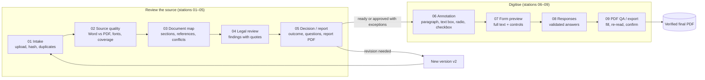
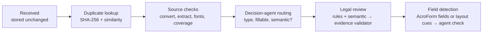

# Architecture and workflow map

Status: implemented and deployed (see the [build log](../../progress/build-log/2026-10-15.md) for verified runs). This page is the map: what a reviewer does, which code does it, and where everything lives.

## 1. The reviewer's workflow

A fund sends investors a subscription booklet to fill in. Before the booklet is digitised into an online form, a reviewer checks the source, decides on every flagged issue, and only then builds and verifies the fillable version. Each step is one station on the hub and one workspace in the app.



Gates that stop the flow: source issues must be resolved or manually confirmed (02); every finding needs a decision (05); uncertain annotations must be confirmed (06); every source block must be represented (07); required answers must be present (08); final export needs QA to pass and the reviewer's confirmation (09).

## 2. System architecture

```mermaid
flowchart TB
    B["Browser — Next.js single page<br/>three.js stations · pdf.js viewer"]
    subgraph Vercel
      API["API routes (src/app/api)<br/>versions · process · report · help · fill"]
      PIPE["Pipeline (src/review/pipeline.ts)<br/>runs after the response"]
    end
    subgraph Supabase
      AUTH[Anonymous auth]
      DB[(Postgres + RLS<br/>owner = auth.uid())]
      ST[(Private storage<br/>sources · exports)]
      RT[Realtime job steps]
    end
    subgraph Worker["Worker (owner's machine, Cloudflare tunnel)"]
      CONV["/convert<br/>sanitise + Word → PDF"]
      DEC["/decide<br/>Laya decision agent"]
      SEM["/semantic<br/>Codex CLI reviewer"]
    end
    B -- session --> AUTH
    B -- direct upload --> ST
    B -- register / actions --> API --> PIPE
    PIPE --> DB
    PIPE --> ST
    DB --> RT --> B
    PIPE -- caller's session --> CONV & DEC & SEM
    PIPE -. optional .-> OAI[OpenAI Responses API]
```

## 3. Processing pipeline (one job per uploaded version)



| Step | Code | Output |
| --- | --- | --- |
| Received, duplicates | `src/app/api/versions/route.ts`, `pipeline.ts` | Immutable version, exact duplicate reopened, related versions |
| Source checks | `src/review/extract.ts`, `source.ts`, worker `/convert` | Blocks with page geometry, font substitution, text loss, coverage |
| Routing | `src/integrations/worker.ts` → `/decide` | Document type, fillable regions, need for semantic review |
| Legal review | `src/review/checks.ts`, `semantic.ts`, `validate.ts` | Findings with matched quotes; rejected candidates listed |
| Field detection | `src/digitize/fields.ts` | Four annotation types; AcroForm widgets used directly when present |
| Report, fill, QA | `src/app/api/versions/[id]/report`, `src/digitize/fill.ts` | Review report PDF; filled PDF re-read and checked |

### Speed

Rules and the semantic reviewer start as soon as text is extracted, in parallel with the decision agent's routing; the review chain (rules, semantic reviewer, evidence gate, ordering) and field detection then run side by side. The worker reviews up to two chunks of a long document at once and queues decision-agent calls on its single model. Long worker calls run as background jobs, because the tunnel ends requests after about 100 seconds.

### Accuracy

`node scripts/e2e-contracts.mjs` scores every run against the planted problems in `data/demo-contracts/expected.json` (problems found, false alarms to avoid, expected form fields); the latest numbers are in the build log.

### Memory

Every reviewer decision is stored append-only in `decision_events` with a snapshot of the finding it was about, so re-running checks (which regenerates findings) keeps the history. Decisions marked "use as example" (up to 12, newest first) are passed to the semantic reviewer on later reviews in the same workspace as data, and the version's notes say how many were used. A new version of a document takes over annotations by content (matched, changed, new, uncertain), and findings missing from the new version are proposed as resolved for the reviewer to confirm. Approved annotation structures are saved as templates for the document family. `node scripts/e2e-memory.mjs` checks all of this against a running app.

## 4. Trust boundaries

- Contract text is untrusted data: it is sent to reviewers as data in a separate field, never as instructions; uploads are sanitised before Word opens them (macros, DTDs, external links and remote fields are refused).
- Every finding needs a source quote that matches the extracted text; contradictions need two.
- Scores (rules, semantic reviewer, decision agent) are shown as uncalibrated; only the reviewer's decisions change the outcome.
- Every table is protected by row-level security; storage paths are per user; the worker accepts only verified sessions and caps semantic calls.

## 5. Where things live

| Category | Folders |
| --- | --- |
| Application | `src/app/` (page, API routes) · `src/components/` (shell, hub, nine workspaces, PDF viewer, 3D) · `src/review/` · `src/digitize/` · `src/integrations/` · `src/lib/` · `public/` |
| Worker | `worker/` (FastAPI service, tunnel runner, sanitiser and quota tests, Dockerfile) |
| Backend | `supabase/migrations/` |
| Design and 3D | `design/` (approved screens, dark mode, 3D references, Blender scene and build script) · `public/3d/` |
| Demo and test data | `data/demo-contracts/` (synthetic fund documents) · `public/demo/` (built-in demo) · `data/synthetic/` · `evals/datasets/` |
| Quality | `tests/` · `worker/test_*.py` · `evals/` · `scripts/e2e-contracts.mjs` |
| Instructions and prompts | `prompts/` · `context/briefs/` · `AGENTS.md` |
| Documentation and evidence | `docs/` · `progress/` (build logs, changelog, roadmap) · `references/` · `demo/` |

The complete folder list is in the [repository map](../repository-map.md).
