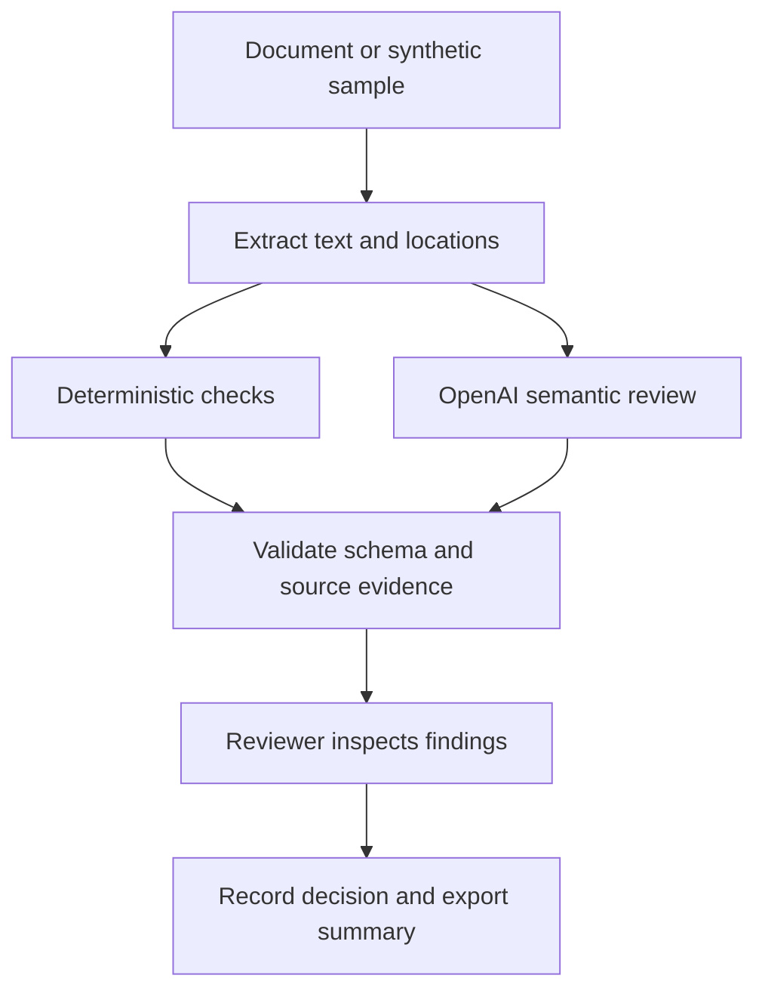

# Architecture proposal

Status: proposed; no hackathon application implementation in `src/` yet.

## Proposed responsibilities

| Location | Responsibility |
| --- | --- |
| `src/app/` | Upload flow, finding list, review actions, export |
| `src/review/` | Text extraction, reference/term checks, evidence validation |
| `src/integrations/` | OpenAI client and optional external services |
| `data/schemas/` | Versioned finding output contract |
| `tests/` | Deterministic behavior and integration error handling |
| `evals/` | Accuracy, grounding, false positives, and instruction isolation |

## Candidate implementation

The local Contract Reader reference uses Streamlit and has local PDF extraction and feedback code. These can inform implementation after reuse review. A lightweight PDF extraction layer and local review storage are candidates, not committed dependencies. Optional OCR is needed for scans; optional Laya experiments must demonstrate value before becoming part of the critical path.

## Trust boundaries

The application instruction and the contract text must travel in distinct fields. Contract text is untrusted data. The model proposes findings; schema validation, quote matching, and reviewer decisions determine whether they are usable. Do not infer missing content from a partial extraction.

## Implementation sequence

First establish extraction and locations, then deterministic checks, then semantic review and validation, then review/export. Record exact dependencies, model configuration, deployment instructions, and data handling when those choices are implemented.
