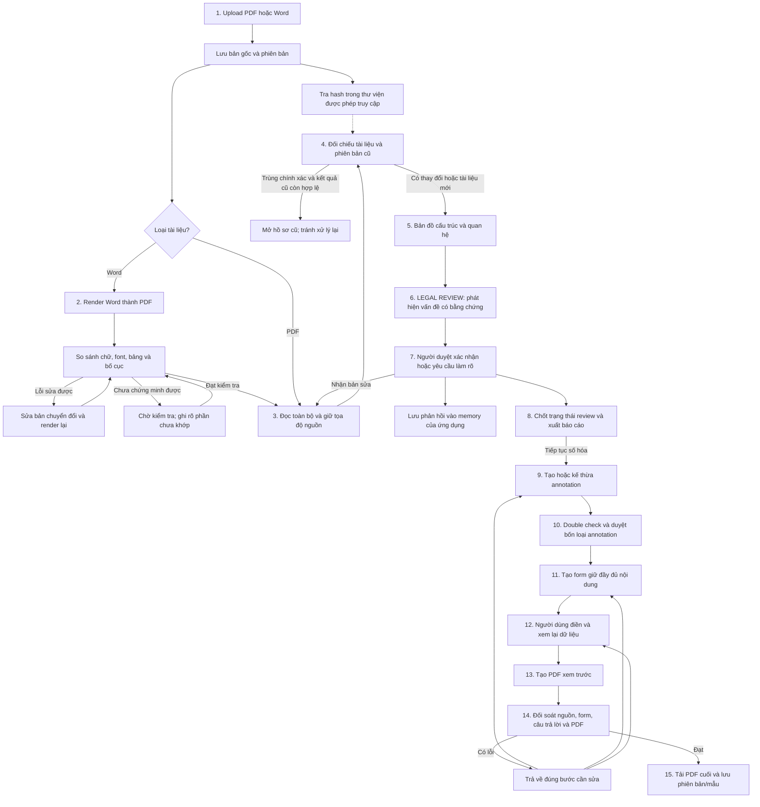
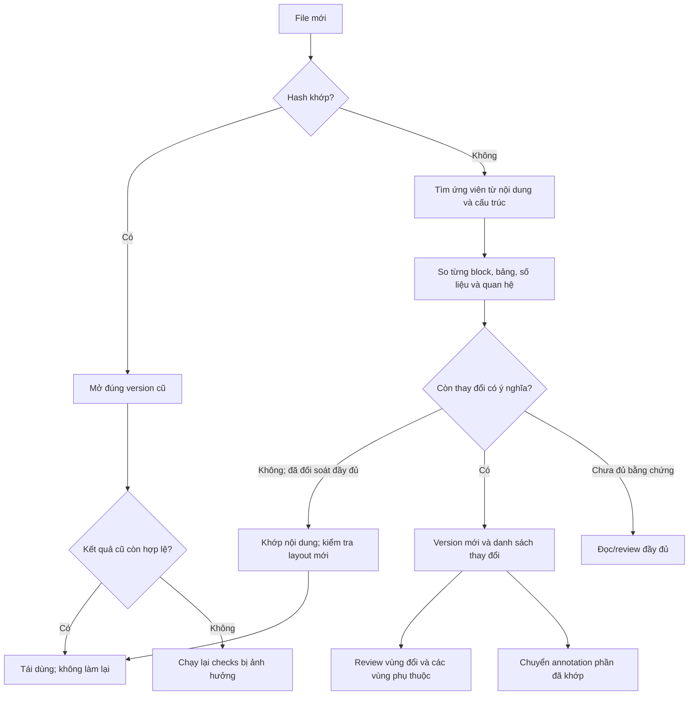
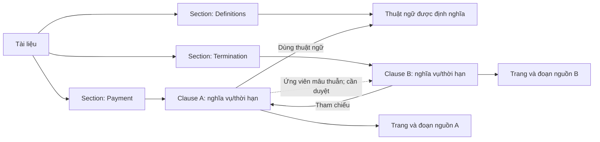
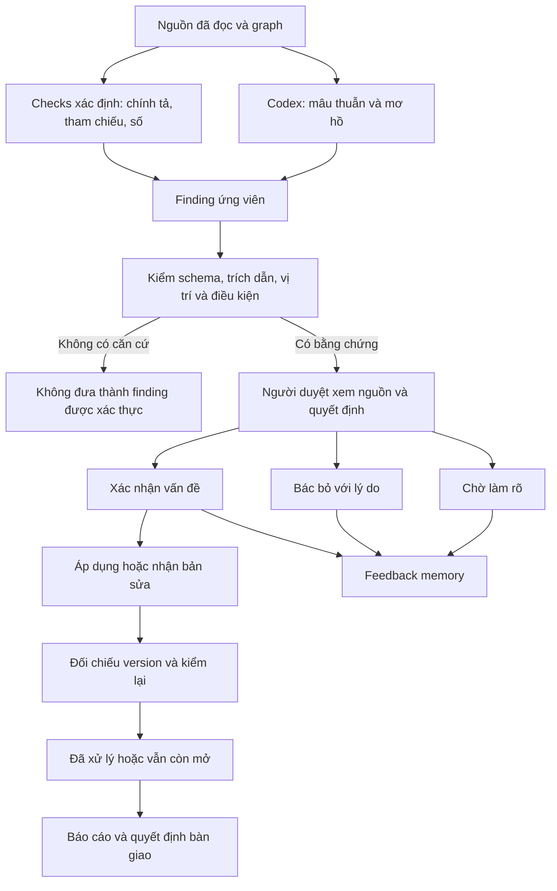
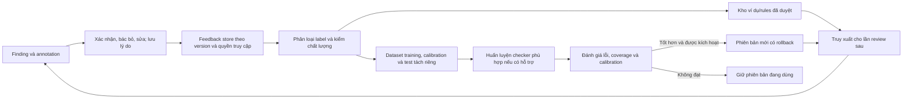
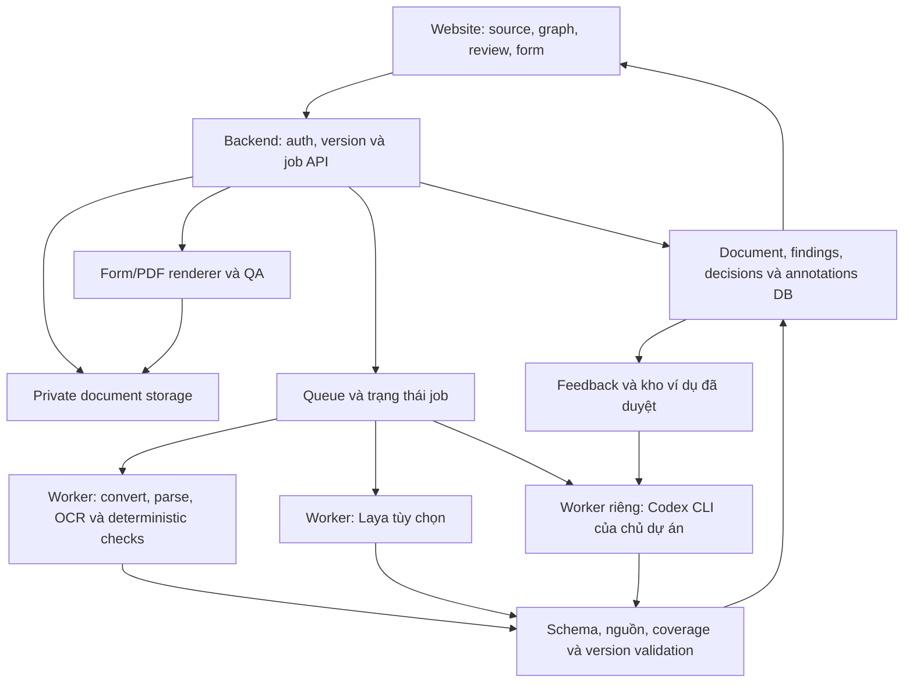
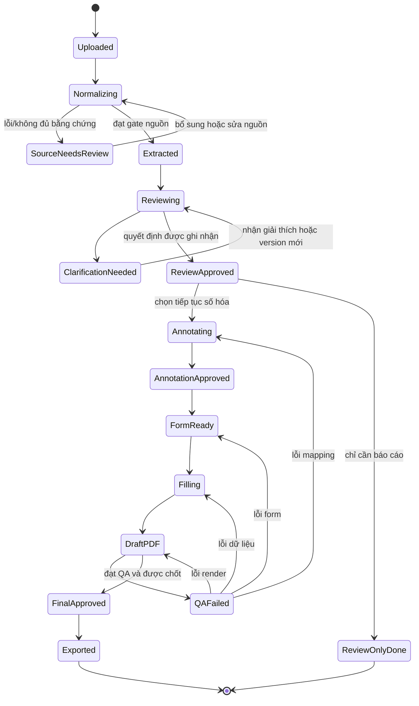

# Anduin Legal Reviewer — kế hoạch hệ thống v2

Ngày: 14/10/2026. Trạng thái: **bản thiết kế đề xuất**, chưa phải chức năng đã triển khai hoặc kết quả đánh giá model. Lưu riêng trên máy; không đưa bản ghi âm, bản chép hay bản kế hoạch này lên GitHub.

## 1. Trọng tâm sản phẩm

Xây một website giúp đội số hóa hợp đồng **phát hiện và xác nhận vấn đề trong tài liệu trước khi bắt đầu số hóa**, tránh làm lại trên đầu vào có lỗi. Đây là bài toán chính trong ảnh: lỗi chính tả, tham chiếu thiếu, điều khoản mâu thuẫn và thuật ngữ mơ hồ; những vấn đề cần giải thích phải được xác nhận với người phụ trách/pháp chế bên ngoài.

Hệ thống đầy đủ nối tiếp bằng: chuẩn hóa Word/PDF → lập bản đồ tài liệu → review và xác nhận → annotation → form tương tác → điền → tạo PDF → đối soát → lưu phiên bản và tái sử dụng.

**Ưu tiên thiết kế:** màn hình review, bằng chứng nguồn, quyết định của người duyệt và vòng phản hồi là trung tâm. Chuyển đổi Word, tìm mẫu trùng, annotation và form giúp hoàn thiện quy trình; chúng không thay thế việc giải đúng đề Legal Reviewer.

Nguồn yêu cầu được phân biệt như sau:

| Nguồn | Vai trò trong bản thiết kế |
| --- | --- |
| Ảnh đề bài người dùng cung cấp | Xác định bài toán review trước số hóa và xác nhận với legal counsel |
| Yêu cầu mới nhất của người dùng | Word → PDF có kiểm tra, bản đồ graph, học phản hồi, bốn loại annotation, Laya/Codex, duplicate, form và đối soát |
| Bản tổng hợp ghi âm trước | Bổ sung các điểm đau vận hành; chỗ nhận dạng chưa rõ không được coi là yêu cầu đã xác nhận |
| Tài liệu hiện có trong dự án | Đối chiếu nguồn, trích dẫn, human review và trạng thái đề xuất |
| Thiết kế trong bản này | Đề xuất cách thực hiện, dữ liệu, giao diện, quality gate và trình tự build |

Trong yêu cầu này, “Codex CI” được hiểu là **Codex CLI của chủ dự án** để chạy các tác vụ suy luận qua một worker. Đây là giả định thiết kế; chưa chạy suy luận hợp đồng hoặc kiểm tra khả năng phục vụ website bằng tài khoản đó.

## 2. Graph tổng thể

Hai việc chạy song song ngay sau upload: chuẩn hóa/đọc nguồn và tra cứu tài liệu đã có. Hash file phát hiện bản giống hệt trước; đối chiếu nội dung chỉ bắt đầu khi đọc đủ dữ liệu. Tìm ứng viên sớm để giảm việc lặp lại, nhưng kết luận trùng phải qua kiểm chứng.

Graph rút gọn nhánh lỗi ở cuối; bảng bước bên dưới xác định thêm trường hợp cần quay về chuyển đổi/đọc nguồn hoặc review. Một lỗi chuyển đổi không được sửa bằng cách thay đổi annotation.

## 3. Luồng xử lý chi tiết cho một file

### Bước 1 — Tiếp nhận và đăng ký tài liệu

**Đầu vào:** PDF, DOCX; file Word định dạng cũ chỉ nhận nếu converter hỗ trợ và vượt qua kiểm tra. Có thể chọn hồ sơ, khách hàng, ngôn ngữ và mẫu liên quan; không bắt người dùng biết template trước.

**Xử lý:**

- Lưu nguyên bản, tên file, loại thực tế, hash, thời gian, người upload, quyền truy cập và version ID.
- Kiểm tra file mở được, có mật khẩu hay thiếu tài nguyên liên kết không. Hiển thị trạng thái để người dùng cung cấp phần thiếu.
- Phân biệt bản gốc, PDF được chuyển đổi, bản sửa và PDF đã điền. Không ghi đè chúng lên nhau.
- Tra hash ngay trong phạm vi dữ liệu người dùng được phép truy cập; đồng thời đưa file vào pipeline chuẩn hóa.

**Đầu ra:** hồ sơ nguồn bất biến và job có trạng thái từng bước. Màn hình upload hiển thị tiến độ thực tế, có thể tiếp tục job khi mở lại.

### Bước 2 — Chuyển Word thành PDF và kiểm tra độ khớp

**Đầu vào:** Word gốc và tài nguyên của nó. PDF đầu vào bỏ qua chuyển đổi, nhưng vẫn kiểm tra khả năng đọc và các lỗi tài liệu nguồn.

**Xử lý đề xuất:**

1. Đọc cấu trúc Word: đoạn, bảng, danh sách, header/footer, footnote/endnote, hình, font và thiết lập trang. Theo dõi comment và tracked changes; người duyệt phải chọn trạng thái bản Word cần dùng nếu điều này chưa rõ.
2. Render Word bằng engine phù hợp. Trên máy có Microsoft Word, ưu tiên thử engine Word; phương án thay thế chỉ được chấp nhận sau đối chiếu trên bộ tài liệu thực tế. Chưa xác minh engine nào đã có trên máy trong tác vụ này.
3. Đối chiếu nội dung Word với text PDF; kiểm tra thiếu/thừa chữ, dấu tiếng Việt, ký tự thay thế, số tiền, ngày, tên, bảng và các vùng ngoài body.
4. Kiểm tra trực quan trên ảnh từng trang: xuống dòng, cắt chữ, chồng vùng, bảng tách trang, hình biến mất, ký hiệu lựa chọn và font không phù hợp. Kiểm tra font được dùng/nhúng trong PDF.
5. Tự sửa khi có cách xác định rõ: khôi phục font gốc nếu có và được phép dùng, nhúng font được hỗ trợ, sửa thiết lập chuyển đổi hoặc khôi phục tài nguyên. Thử lại một số lần có giới hạn; giữ lịch sử thay đổi.
6. Nếu thiếu font hoặc không có bản render Word đáng tin cậy để so, đánh dấu phần chưa kiểm chứng và cho người dùng xem hai bản. Không âm thầm thay font hoặc viết lại hợp đồng để đạt điểm giống cao.

**Quality gate:** không có nội dung thiếu/thừa chưa giải thích; không có lỗi font, clipping hay bảng bị mất đã phát hiện mà chưa xử lý. Nếu có baseline hiển thị Word, đối chiếu từng trang với baseline. So hai output của cùng một engine chỉ chứng minh tính nhất quán của engine, không chứng minh engine đã hiển thị đúng ý tác giả.

**Đầu ra:** PDF chuẩn hóa, bản báo cáo đối chiếu và trạng thái `verified`, `needs_review` hoặc `blocked`. “100%” là yêu cầu về độ đầy đủ và việc đối soát; chưa có cơ sở hứa chuyển mọi Word đều giống tuyệt đối trên mọi môi trường.

**Tách hai loại sửa:** sửa lỗi chuyển đổi được phép làm ở bước này; thay câu chữ pháp lý đi qua review và phê duyệt phiên bản ở bước 7.

### Bước 3 — Đọc đầy đủ tài liệu và neo về nguồn

- Trích text trực tiếp khi PDF có text; OCR những trang/vùng cần OCR. Tài liệu mixed text/scan được xử lý theo vùng.
- Giữ page, block, paragraph, bảng, cell, bounding box và thứ tự đọc; footnote và header/footer có loại vùng riêng.
- Với Word, giữ liên kết giữa block Word và block PDF; nếu không xác định được thì báo trạng thái ánh xạ chưa rõ.
- Ghi vùng chưa đọc, thứ tự đọc nghi vấn, OCR yếu hoặc trang bị lỗi. Không review như thể đã đọc hết khi còn thiếu vùng.
- Tạo coverage manifest: toàn bộ trang và vùng nội dung đã nhận diện phải có trạng thái đọc, liên kết hoặc lý do chưa đọc.

**Đầu ra:** Document Representation — nội dung có cấu trúc, vị trí nguồn và tình trạng extraction. Đây là nền chung cho graph, review, duplicate, annotation và form.

### Bước 4 — Tìm bản trùng và mẫu liên quan

**Mục tiêu:** nếu đúng là cùng tài liệu đã xử lý thì người dùng không làm lại; nếu khác một hai trang, hệ thống tận dụng phần còn đúng và đưa phần khác ra kiểm tra.

| Kết quả | Căn cứ | Hành động |
| --- | --- | --- |
| Trùng file chính xác | Hash/byte identity | Mở phiên bản cũ; có thể tái dùng kết quả còn hợp lệ |
| Khớp nội dung, khác định dạng | Nội dung, bảng, cấu trúc và tài nguyên quan trọng khớp qua đối soát; chỉ khác biểu diễn đã giải thích | Dùng lại nội dung review; kiểm tra lại bố cục và tọa độ annotation |
| Cùng họ template nhưng có sửa | Có block khớp và có thay đổi được liệt kê | Tạo phiên bản mới; review phần đổi và các điều khoản phụ thuộc; chuyển annotation đã đối chiếu |
| Chỉ tương tự | Đề tài/bố cục gần nhau; chưa chứng minh đồng nhất | Dùng làm ứng viên tham khảo; không bỏ review |
| Không đủ dữ liệu | OCR/extraction thiếu hoặc nghi vấn | Chưa kết luận duplicate; giải quyết phần đọc trước |

**Cách tìm:** exact hash → chỉ mục nội dung/đoạn để thu hẹp ứng viên → so text, bảng và các graph liên quan. Laya hoặc embedding có thể xếp hạng ứng viên; Codex giải thích thay đổi khó. Kết luận trùng không dựa vào model nói “yes” hoặc một điểm similarity.

Chuẩn hóa chỉ được loại các khác biệt biểu diễn đã biết, như ngắt dòng do layout; vẫn giữ bản nguồn và diff. Không bỏ qua dấu phủ định, số tiền, ngày, tên, lựa chọn, nghĩa vụ hoặc các phần có nội dung. Mọi phép chuẩn hóa phải có bản ghi và khả năng truy ngược.

**Quy tắc tái dùng:** kết quả cũ phải thuộc đúng quyền truy cập, đúng version, đúng rules/prompt/model configuration và chưa bị thu hồi. Khi rules thay đổi, chạy lại phần kiểm tra bị ảnh hưởng. Bản trùng từng bị chặn vẫn mở trạng thái bị chặn; không biến thành bản đã duyệt.

### Bước 5 — Hiểu cấu trúc và tạo bản đồ nội dung

Hiển thị ba lớp thay vì một graph khổng lồ:

1. **Cây nội dung:** document → section → clause → paragraph/table/field. Mỗi node nhảy về đúng trang và highlight nguồn.
2. **Graph quan hệ:** điều khoản tham chiếu điều khoản nào, thuật ngữ được định nghĩa/dùng ở đâu, chủ thể có nghĩa vụ nào, mốc thời gian liên quan đến nội dung nào. Quan hệ AI suy luận có nhãn “đề xuất”; quan hệ được parse hoặc duyệt có trạng thái riêng.
3. **Bản đồ trang:** thumbnail và lớp màu cho nội dung đọc, field, finding, vùng chưa đọc, vùng đổi so với version cũ.

Filter theo loại node/edge, section, finding và mức xác nhận. Thu gọn graph theo section, tìm từ khóa và mở vùng liên quan; các đoạn dài hiển thị ở panel chi tiết, không nhồi toàn bộ vào node.

**Đầu ra:** graph và outline gắn nguồn, không phải sơ đồ tóm tắt làm mất điều khoản.

Graph trên là ví dụ cấu trúc tổng hợp, không phải kết quả phân tích một hợp đồng thật.

### Bước 6 — Review tài liệu: chức năng chính của đề

| Nhóm | Cần tìm gì | Cách xử lý đề xuất | Bằng chứng bắt buộc |
| --- | --- | --- | --- |
| Chính tả | Sai ký tự/từ, bất nhất cách viết | Proofing, glossary tên/thuật ngữ, AI cho trường hợp phụ thuộc ngữ cảnh | Câu nguồn và từ bị đánh dấu |
| Tham chiếu/đánh số | Trỏ mục/phụ lục/footnote không tồn tại; đánh số đáng nghi | Reference parser, numbering rules, graph | Câu dẫn và mục đích tìm được hoặc kết quả không tìm thấy |
| Mâu thuẫn | Hai quy định không thể cùng đúng trong cùng điều kiện | So quan hệ/chủ thể/điều kiện + Codex semantic review | Cả hai đoạn, điều kiện áp dụng, lý do nghi vấn |
| Mơ hồ | Thuật ngữ/cụm từ có nhiều cách hiểu; mốc hoặc điều kiện chưa rõ | Định nghĩa và ngữ cảnh + Codex | Đoạn nguồn, cách hiểu cần xác nhận, câu hỏi rõ ràng |
| Thuật ngữ chưa định nghĩa | Dùng term có vẻ cần định nghĩa nhưng thiếu/khác định nghĩa | Definition graph + rules + duyệt | Nơi dùng, phạm vi tìm định nghĩa |
| Thiếu cấu phần có căn cứ | Thiếu phần được tài liệu/checklist được duyệt yêu cầu | Đối chiếu checklist có nguồn | Điều khoản/checklist yêu cầu; phạm vi đã kiểm tra |

Bốn nhóm đầu bám đề chính. Hai nhóm sau là mở rộng. Không tự tạo kết luận về tính hợp pháp ở một quốc gia nếu chưa có nguồn, phạm vi và người có trách nhiệm xác nhận.

**Finding phải có:** ID; loại; tiêu đề; document/version; exact quote(s); page/section/block/bbox; lý do; câu hỏi gửi người xác nhận; đề xuất sửa nếu có; mức ảnh hưởng; điểm model và cơ sở hiệu chỉnh; trạng thái bằng chứng; prompt/model/rule version; trạng thái người duyệt.

Pipeline: sinh ứng viên → kiểm tra schema → quote matching → kiểm tra source version → loại finding không có căn cứ → gom vấn đề trùng → hiển thị người duyệt. Cần cho phép kết quả không có finding khi tài liệu không phát hiện vấn đề; không ép AI tìm đủ số lỗi.

Không chỉ so từng chunk độc lập: lập index tham chiếu, định nghĩa, chủ thể và thời hạn để nối các đoạn xa nhau; semantic review lấy đủ các đoạn liên quan và phần điều kiện/ngoại lệ. Nếu context bị cắt, job không được đánh dấu đã review toàn bộ.

### Bước 7 — Xác nhận, bác bỏ, sửa và làm rõ

Mỗi finding có các thao tác: xác nhận vấn đề; bác bỏ và nêu lý do; sửa đề xuất; cần làm rõ; ghi câu trả lời của người xác nhận; đánh dấu đã xử lý sau khi kiểm tra bản sửa.

**Phân biệt bắt buộc:** “đã xác nhận đây là lỗi” chưa phải “lỗi đã được sửa”. Chấp nhận đề xuất sửa cũng chưa chứng minh bản tài liệu mới đã áp dụng đúng sửa đổi đó.

- So bản sửa với bản trước, hiển thị đúng thay đổi và recheck finding/vùng phụ thuộc.
- Chuẩn bị danh sách câu hỏi và bằng chứng để gửi pháp chế. Việc gửi bên ngoài là hành động riêng có chủ đích của người dùng; kế hoạch này không gửi gì.
- Ghi cả sự kiện bác bỏ: thiếu chứng cứ, không áp dụng trong trường hợp này, trùng finding, lỗi model, hoặc vấn đề có thật nhưng người duyệt chấp nhận giữ nguyên. Các lý do này không cùng một nhãn huấn luyện.
- Mọi phản hồi được ghi vào kho feedback của ứng dụng, rồi chọn lọc để cải thiện lần sau.

### Bước 8 — Chốt review và bàn giao cho số hóa

Hiển thị một trong các trạng thái:

| Trạng thái | Ý nghĩa |
| --- | --- |
| Ready for digitization | Các kiểm tra yêu cầu đã hoàn tất; vấn đề chặn đã có xử lý hoặc quyết định có trách nhiệm |
| Needs clarification | Còn câu hỏi chờ người xác nhận; chỉ tiếp tục phần đã được phép |
| Blocked by source quality | Nguồn chưa đọc/chuyển đổi đủ tin cậy |
| Approved with exceptions | Người có thẩm quyền cho tiếp tục với ngoại lệ được ghi rõ |

**Đầu ra cốt lõi:** review report có bằng chứng, quyết định, câu hỏi, lịch sử sửa và vấn đề còn mở. Có thể kết thúc công việc ở đây mà đã giải được đề chính.

### Bước 9 — Chuẩn bị annotation mới hoặc kế thừa

Theo yêu cầu mới nhất, hệ thống có **đúng bốn loại chính**:

| Loại | Cách dùng | Dữ liệu cần có |
| --- | --- | --- |
| Paragraph | Nội dung để đọc: điều khoản, câu hỏi, hướng dẫn | Text gốc, thứ tự, source block, khả năng hiển thị |
| Text box | Vùng nhập câu trả lời | Nhãn, nguồn, kiểu dữ liệu, ô bắt buộc nếu đã xác nhận, vùng điền |
| Radio box | Nhóm lựa chọn một đáp án | Group ID, lựa chọn và ý nghĩa từng giá trị |
| Checkbox | Lựa chọn bật/tắt hoặc chọn nhiều theo tài liệu | Option/group, rule chọn đúng theo nội dung |

Paragraph là vùng nội dung, không phải chỗ trống để điền. Vùng chữ ký vẫn được giữ trong nội dung hợp đồng; chức năng ký là khả năng riêng chỉ bổ sung khi quyết định triển khai, không tự thêm loại annotation thứ năm vào bản kế hoạch này.

**Tạo mới:** tìm đoạn đọc và vùng cần điền, đề xuất loại, nhãn và group. Heuristics nhìn dòng trống/ô/hình; Laya phân loại ngữ cảnh đã trích; Codex xử lý chỗ phức tạp. Người duyệt luôn xem nguồn để sửa loại/vùng.

**Kế thừa:** tìm source block tương ứng trong version mới; kiểm tra nhãn, câu hỏi, option và ý nghĩa; tính lại bbox. Vùng `matched` được chuyển; `changed`, `new`, `missing`, `uncertain` được đưa ra kiểm tra. Chèn/xóa trang không làm toàn bộ mapping lệ thuộc vào số trang cũ.

Field ID ổn định tách khỏi page/bbox. Tên ba cấp là đề xuất, ví dụ minh họa `investor.identity.full_name`; không coi đây là naming convention đã được xác nhận từ ghi âm.

### Bước 10 — Double check annotation và duyệt

Các kiểm tra xác định: đủ source block; bbox nằm trong trang; không trùng field ID; option đúng group; loại annotation thuộc bốn loại; mỗi input liên kết được với câu hỏi/hướng dẫn; paragraph giữ đủ nội dung và đúng thứ tự.

Model check bổ sung: Laya đánh giá loại/nhóm từ ngữ cảnh, Codex kiểm tra trường hợp hai checker bất đồng hoặc cần hiểu rộng. Kiểm tra hình học/render xác minh vị trí, vì Laya text không tự đọc tọa độ trên trang.

**Double check không đồng nghĩa hai model cùng trả lời thì chắc đúng.** Chỉ đồng thuận model chưa đủ; phải kiểm nguồn, rules và coverage. Giữ mục “chưa chắc”, cho người duyệt sửa trực tiếp và xem preview.

**Đầu ra:** annotation version được duyệt, thông tin người duyệt và những ngoại lệ còn mở. Lưu vào template library tách biệt khỏi câu trả lời cá nhân.

### Bước 11 — Sinh form tương tác đầy đủ, dễ hiểu

- Giữ mọi nội dung của phiên bản hợp đồng đã chốt. Mỗi source block phải có representation trên form hoặc vùng phụ lục tương đương và liên kết rõ ràng.
- Có thể chia section, accordion, mục lục và progress để đọc dễ hơn; “dễ hiểu” không cho phép âm thầm tóm tắt/bỏ điều khoản.
- Nếu thêm diễn giải ngôn ngữ dễ hiểu, đặt thành lớp hỗ trợ riêng, phân biệt với nguyên văn và liên kết về nguyên văn.
- Render đúng bốn component; paragraph chứa nội dung/hướng dẫn; text box nhập; radio chọn một; checkbox theo rule được duyệt.
- Bản gốc hiển thị cạnh form, click vào field nhảy về nguồn và ngược lại.
- Dữ liệu gõ vào được lưu vào answer record và mapping PDF ngay theo field ID; preview thể hiện đúng version.
- Conditional visibility/required chỉ dựa trên điều kiện trong hợp đồng hoặc rules được người phụ trách duyệt. Người xem vẫn có cách mở toàn bộ nội dung gốc, kể cả section đang không áp dụng.

**Đầu ra:** form preview và báo cáo coverage trước khi cho người dùng điền.

### Bước 12 — Điền, lưu nháp và xác nhận câu trả lời

Lưu nháp theo hồ sơ, người điền và version; kiểm dữ liệu bắt buộc/format/option theo rule đã duyệt; chỉ ra từng ô còn thiếu; cho xem lại trước khi tạo PDF. Thay đổi template không tự chuyển dữ liệu vào field khác.

Nếu muốn chuyển câu trả lời từ hồ sơ cũ, tách thành tính năng riêng: đúng người/hồ sơ, cùng ý nghĩa field và người dùng xác nhận. **Tái dùng annotation không tự tái dùng câu trả lời.**

### Bước 13 — Tạo PDF đã điền

Map từng value bằng field ID và bbox của đúng version, điền text/option vào PDF; kiểm xuống dòng, ô dài, dấu tiếng Việt, font và clipping. Hiển thị PDF xem trước. Khi không đủ chỗ, hiển thị lỗi và phương án được duyệt, không cắt chữ để ép vừa.

Giữ nguyên nội dung đã chốt và những thay đổi được duyệt. Không thêm giá trị ở vùng paragraph hoặc bỏ điều khoản để dành chỗ nhập. Chữ ký điện tử nếu có cần thiết kế riêng; chưa được mặc định là tính năng đã có.

### Bước 14 — Đối soát trước khi cấp bản PDF cuối

Theo mong muốn “tải PDF rồi double check”, hệ thống **tạo PDF → double check → cho tải bản cuối**. Nếu cho tải trước, bản đó phải ghi rõ là bản nháp chưa duyệt; lượt kiểm sau tải vẫn có thể bổ sung nhưng không thay thế gate trước xuất bản cuối.

| Đối soát | Điều kiện cần kiểm | Lỗi quay về |
| --- | --- | --- |
| Word → PDF chuẩn hóa | Nội dung và bố cục chưa khớp | Bước 2–3 |
| Nguồn → form | Mất paragraph, sai thứ tự/câu hỏi | Bước 9–11 |
| Annotation → form | Sai control/option/group | Bước 9–11 |
| Câu trả lời → PDF | Nhầm field, thiếu/tràn/sai value | Bước 12–13; mapping sai về 9 |
| Nguồn đã chốt → PDF cuối | Điều khoản gốc bị mất hoặc bị thay ngoài phê duyệt | Bước 13; nguồn chưa chốt về 7–8 |
| Feedback/finding → version | Finding đã resolved nhưng lỗi còn; review cũ không áp dụng | Bước 6–8 |

Đối soát text, cấu trúc, values, options và render từng trang. Lỗi chưa giải quyết phải còn nhìn thấy; người dùng không nhận nhãn “hoàn tất” khi job bị thiếu bước.

### Bước 15 — Xuất, lưu và tái sử dụng

Xuất PDF cuối, review report, QA report và bảng lịch sử phiên bản. Lưu nguồn, bản chuyển đổi, findings/decisions, annotation, form schema, answers, export manifest và fingerprints.

Một bản template là cấu trúc được phép tái dùng; một bản submission là câu trả lời của hồ sơ cụ thể. Hai phần có ID và quyền truy cập riêng. Lần upload sau có thể mở hồ sơ cũ hoặc chỉ xử lý vùng thay đổi mà không làm lại phần đã chứng minh khớp.

## 4. Học từ phản hồi và hiển thị độ tin cậy

### 4.1. Ba cơ chế khác nhau

| Cơ chế | Khi nào hoạt động | Nó cải thiện gì |
| --- | --- | --- |
| Ghi memory | Ngay khi có thao tác, tự lưu sự kiện đúng version | Giữ nguyên quyết định/lý do/bản sửa và khả năng truy lại |
| Retrieval + rules | Phản hồi đã đủ điều kiện dùng được truy xuất ở lần review sau | Gợi ý theo ví dụ và checklist đã duyệt, không đổi trọng số model |
| Training/calibration | Theo đợt trên dữ liệu đã được kiểm, có đánh giá trước kích hoạt | Cải thiện model/checker và độ khớp của điểm tin cậy với thực tế |

Không mô tả một click “accept” là đã huấn luyện lại model. Chạy Codex CLI với ví dụ từ memory cũng không tự fine-tune Codex. Muốn fine-tune một model phải có backend/model hỗ trợ, pipeline riêng và đánh giá; không tự đổi kênh inference mà người dùng đã chọn.

### 4.2. Feedback record cần lưu

Document/version, finding/annotation ID, nguồn liên quan, output cũ, điểm model, người quyết định và vai trò, loại hành động, lý do, correction đề xuất, correction thực tế đã chốt, thời gian, rules/prompt/model version và scope áp dụng.

- Người điền form báo UI lỗi khác với người review xác nhận vấn đề hợp đồng; label phải giữ đúng vai trò.
- “Accept finding”, “accept wording”, “accept exception” và “resolved after revision” là các sự kiện khác nhau.
- Một quyết định cho hợp đồng cụ thể không tự biến thành luật cho mọi hợp đồng.
- Không lấy bản đang chờ xác nhận làm ví dụ đúng. Khi có quyết định mâu thuẫn, giữ lịch sử và cho người phụ trách giải quyết.
- Memory này thuộc ứng dụng Legal Reviewer, không phải ghi vào thư mục personal memory của Codex trong tác vụ lập kế hoạch này.

### 4.3. Vòng cải thiện

**Dataset law/review:** dùng tài liệu và nhãn review mà chủ dự án có quyền sử dụng, đã kiểm nguồn và người gán nhãn. Chưa có dataset review pháp lý nào được cung cấp/kiểm trong tác vụ này. Ví dụ tổng hợp dùng kiểm đường đi và regression, không chứng minh model giỏi trên hợp đồng thật.

Tách train/calibration/test theo họ template, hồ sơ và phiên bản; tránh đưa gần như cùng một hợp đồng vào cả train và test. Giữ bộ test cố định trước lần cải thiện; đánh giá riêng ngôn ngữ, loại finding và loại field.

### 4.4. UI độ tin cậy

Hiển thị riêng:

1. **Điểm model:** nguồn model, ý nghĩa điểm và version; chưa hiệu chỉnh thì ghi “chưa hiệu chỉnh”, không gọi là xác suất đúng.
2. **Kiểm chứng bằng chứng:** trích dẫn khớp nguồn chưa, đã đọc đủ phạm vi chưa, có cả hai đoạn cho mâu thuẫn chưa.
3. **Trạng thái người duyệt:** chưa duyệt, xác nhận, bác bỏ, chờ làm rõ, đã xử lý.
4. **Calibration nếu có:** dataset/version, số mẫu, loại task/ngôn ngữ và kết quả đánh giá. Độ tin cậy trên bộ test là ước lượng cho phạm vi đó, không cam kết mọi finding đúng.

Ví dụ UI tổng hợp, không phải số đo: “Model score: chưa hiệu chỉnh · Trích dẫn: khớp · Reviewer: chờ xác nhận”. Sau khi có calibration hợp lệ có thể hiển thị phần trăm kèm cơ sở. Không tự cộng điểm do hai model đồng ý, hoặc đẩy lên 100% chỉ vì người dùng đã accept.

**Laya:** `confidence` và `answer_confidence` có ý nghĩa khác nhau. Tài liệu upstream yêu cầu kiểm/hiệu chỉnh trên dữ liệu riêng trước dùng điểm để gate. Thiết kế phải lưu cả tên field confidence, checkpoint, số lựa chọn và trạng thái truncation; không đọc đại một số thành “độ chính xác”. [Tài liệu chính thức về Laya confidence](https://github.com/NandhaKishorM/laya/blob/main/docs/questions-and-answers.md).

## 5. Dùng Laya, layout và Codex ở đâu

Đã kiểm read-only folder `laya/`: có checkpoint English, multilingual và typed-decisions. README/examples mô tả typed decisions trên text/state; một log cũ cho thấy bài test phân loại billing, không phải test review pháp lý. Không chạy lại model hoặc benchmark trong tác vụ này.

| Bước | Checker nhanh/xác định | Vai trò Laya đề xuất | Vai trò Codex CLI đề xuất |
| --- | --- | --- | --- |
| Word → PDF | Parser, converter, font/text/render diff | Không làm converter hoặc xác minh pixel | Giải thích sai khác khó dựa trên nguồn/ảnh khi hỗ trợ; không sửa nghĩa tự động |
| Đọc + cấu trúc | PDF/Word parser, OCR, bbox và reading order | Gợi ý loại section/block theo text | Hiểu cấu trúc phức tạp, đề xuất quan hệ có nguồn |
| Duplicate | Hash, content index, block/table diff | Sàng lọc cặp ứng viên theo text | Giải thích khác biệt semantic; không tự cấp nhãn exact |
| Review | Chính tả, reference/numbering/definition graph | Phân loại ứng viên và thứ tự ưu tiên | Đề xuất mâu thuẫn/mơ hồ với các đoạn nguồn liên quan |
| Annotation | Blank/control detection và geometry | Gợi ý paragraph/text box/radio/checkbox | Giải quyết nhóm/nhãn/logic phức tạp có căn cứ |
| Double check | Coverage, field/group IDs, source/render comparison | Checker phụ sau đánh giá trên task | Xem bất đồng và phần chưa chắc; giữ human review |
| Học phản hồi | Feedback DB, curated rules, retrieval | Có thể training riêng nếu đủ dữ liệu và kiểm chứng | Dùng ví dụ đã duyệt ở inference; không tự thay trọng số Codex |

**Laya ≠ layout detector.** Nếu cần model nhìn bố cục ảnh, tạo một adapter riêng nhận ảnh trang và trả vùng nội dung/bbox, rồi kiểm chứng trên file có bảng, cột và scan. Chưa chọn hoặc tuyên bố đã có model layout phù hợp trong folder. Laya dùng metadata layout đã được trích để phân loại, không thay parser/OCR/vision.

Với hợp đồng dài, chia theo section và nối bằng document graph. Kiểm token/truncation; trường hợp cần quan hệ xuyên đoạn phải lấy lại đủ context. Chỉ giữ Laya ở đường chạy chính nếu benchmark cùng dữ liệu chứng minh giảm thời gian/cost với chất lượng đáp ứng mục tiêu; không lấy benchmark máy khác làm thời gian hứa cho site.

### 5.1. Kiến trúc Codex CLI của chủ dự án

Website gửi job đến backend có xác thực → queue → worker trên máy/server riêng nơi CLI đã được đăng nhập → output schema → kiểm source evidence → kết quả về UI. Không đặt credential CLI vào frontend. Chỉ worker được quyền chạy CLI; upload không được dùng để dựng shell command.

CLI hiện có `codex exec`, `--output-schema`, `--json`, `-o` và chế độ read-only trong help local. Tài liệu chính thức xác nhận cách chạy không tương tác và output schema; đây là khả năng công cụ, chưa chứng minh pipeline review đã chạy. [OpenAI: Non-interactive mode](https://learn.chatgpt.com/docs/non-interactive-mode).

Backend chọn task/rules cố định; hợp đồng vào như dữ liệu không đáng tin, không được điều khiển lệnh hoặc mục tiêu của worker. Request ID/version ID ràng buộc output; schema đúng vẫn cần quote matching và reviewer.

Worker cần timeout, retry có giới hạn, hủy job, kiểm quota, logging tối thiểu, không trả output của người khác và khả năng phục hồi. Các job cùng phiên bản/config có thể cache sau kiểm chứng. Nếu local worker offline, UI hiển thị chờ worker; không giả vờ đã review.

**Topology đề xuất:** public/site UI có thể chạy trên hosting hiện có; worker là service riêng. Không giả định việc deploy UI đồng thời chạy được CLI trên hosting đó. Dùng Codex CLI có thể gửi input tới dịch vụ model theo cấu hình; không gọi đây là AI hoàn toàn offline. Tác vụ hiện tại chỉ đọc help, không gửi hợp đồng cho CLI.

## 6. Bố cục website

### 6.1. Điều hướng theo hồ sơ

Luồng chính trên sidebar/stepper:

**Intake → Source quality → Document map → Legal review → Decision/report → Annotation → Form preview → Responses → PDF QA/export.**

Duplicate candidates hiển thị ở Intake/Source quality, không thêm một bước làm người dùng phải tìm mẫu thủ công. Memory/feedback và template library là trang quản lý riêng. Trên trang tổng quan hồ sơ luôn thấy version đang làm và bước tiếp theo.

### 6.2. Màn hình trung tâm: Legal Review Workspace

| Vùng | Nội dung | Hành động chính |
| --- | --- | --- |
| Header | Tên file/version, chất lượng nguồn, trạng thái review, job | Đổi version, so version, mở report |
| Cột trái | Outline, filters, graph liên quan và vùng chưa đọc | Chọn section, lọc loại finding, tìm term/reference |
| Vùng giữa | PDF viewer, highlights, source anchors | Click quote đến nguồn, xem hai đoạn mâu thuẫn |
| Panel phải | Finding, lý do, điểm và cơ sở confidence, câu hỏi, đề xuất | Xác nhận, bác bỏ có lý do, sửa đề xuất, chờ làm rõ |
| Thanh trạng thái | Số finding đang mở và source coverage thực tế | Chốt review khi đủ điều kiện hoặc ghi ngoại lệ |

Màn hình này là phần demo chính. Graph giúp dẫn tới bằng chứng; người dùng vẫn quyết định từ nguồn, không từ màu node.

### 6.3. Các màn hình hỗ trợ

| Màn hình | Thông tin cần thấy |
| --- | --- |
| Intake/dashboard | File, version, trạng thái job, trùng chính xác/ứng viên gần giống, khả năng mở lại hồ sơ |
| Source quality | Word/PDF cạnh nhau, diff theo trang, font/text/layout issues, phần chưa kiểm chứng và retry |
| Document map | Outline/relationship graph/page map; filter và click về nguồn |
| Review decision/report | Findings và quyết định, câu hỏi pháp chế, bản sửa và unresolved items |
| Annotation workspace | PDF + vùng + bốn loại controls + tên/group; so mẫu cũ/new; panel chưa khớp |
| Form preview | Form đầy đủ nội dung, PDF nguồn cạnh bên, coverage và rule được duyệt |
| Responses | Lưu nháp, progress thật, câu trả lời theo version và kiểm lại |
| PDF QA/export | PDF xem trước, lỗi mapping/text/render, quyết định chốt và tải cuối |
| Memory/template management | Ví dụ đã duyệt, scope áp dụng, phản hồi, version/checkpoint và lịch sử kích hoạt |

Public project hub tiếp tục dùng tên tính năng trung lập; tên provider/runtime chỉ nằm ở tài liệu kỹ thuật hoặc phần cấu hình nội bộ phù hợp.

## 7. Dữ liệu và trạng thái hệ thống

| Entity | Dữ liệu tối thiểu và quan hệ |
| --- | --- |
| Document | Chủ sở hữu/scope, document family, source file, hash |
| DocumentVersion | Parent version, content fingerprint, converted PDF, conversion settings và QA |
| SourceBlock | Version, text nguyên văn, type, page/bbox, Word anchor nếu có, extraction status |
| GraphEdge | Node nguồn/đích, relation type, evidence, proposed/verified status |
| DuplicateComparison | Hai version, diff, phạm vi khớp, phần chưa đọc, kết luận và người duyệt |
| Finding | Category, quote(s), source anchors, rationale/question, score provenance, current status |
| DecisionEvent | Actor/role, action/reason, finding/version, before/after và thời điểm |
| Annotation | Một trong bốn types, field/group IDs, source anchor, bbox và approval |
| FormVersion | Source/annotation version, components, visibility/validation rules và content coverage |
| Submission | Người/hồ sơ, form version, answer values, draft/confirmed status |
| Export | PDF/version, answers snapshot, QA manifest, final/draft status |
| FeedbackExample | Decision/correction, label quality, scope, eligible-for-retrieval/training status |
| Job/Run | Task, config/input hashes, worker status, coverage, errors và output artifacts |

Ghi quyết định bằng event history; current status là view từ các sự kiện. Dùng version ID xuyên suốt để không gán finding hoặc câu trả lời của bản cũ sang bản mới mà không có đối chiếu.

Version mới sinh ra một vòng xử lý có trace tới vòng trước; không làm mất lịch sử trạng thái cũ. Exact duplicate mở vòng cũ hoặc tạo job recheck theo config, không tạo finding trùng vô ích.

## 8. Plan build theo ưu tiên

Không gán thời gian hoàn thành khi chưa có benchmark hoặc xác định đầy đủ môi trường. Chia theo điều kiện hoàn tất có thể kiểm tra:

| Giai đoạn | Deliverable | Điều kiện hoàn tất | Ưu tiên |
| --- | --- | --- | --- |
| A. Nền nguồn | Upload/version, parser, anchors, coverage, PDF viewer, Word conversion spike | Có tài liệu đọc được và lỗi nguồn hiển thị đúng; biết giới hạn converter | Nền bắt buộc |
| B. Reviewer | Bốn nhóm đề bài, reference graph, Codex adapter, evidence validation, workspace quyết định | Finding có source; mâu thuẫn có hai đoạn; quyết định được lưu/export | Trọng tâm hackathon |
| C. Feedback | Memory có scope, retrieval ví dụ được duyệt, so version, calibration/eval harness | Click được lưu đúng nhãn; đánh giá trước khi bật thay đổi | Trọng tâm nâng chất lượng |
| D. Quality/reuse | Word đối soát + sửa có giới hạn, exact duplicate, near-version diff, impact recheck | Không bỏ review của bản đổi; không ghi nhãn khớp khi chưa chứng minh | Mở rộng vận hành |
| E. Annotation | Đúng bốn loại, transfer theo nội dung, QA coverage/geometry, preview | Mỗi vùng/field có nguồn và người duyệt; phần không khớp hiện rõ | Mở rộng số hóa |
| F. Form/PDF | Full-content form, submissions, mapped PDF, QA trước tải cuối | Nội dung đủ, values đúng, không cắt/tràn âm thầm | Hoàn thiện quy trình |
| G. Training có kiểm chứng | Dataset review có nhãn, checker phù hợp, calibration, evaluation và rollback | Chứng minh tốt hơn trên dữ liệu chưa dùng để train; không có leakage | Sau khi đủ dữ liệu |

Exact hash/feedback persistence có thể làm sớm trong A/B; bảng biểu diễn độ sâu hoàn thiện, không bắt đợi đến D mới có tra hash. Word conversion spike làm sớm để nhận diện rủi ro, nhưng không để tham vọng sửa mọi Word làm chậm việc chứng minh reviewer hoạt động.

**Kịch bản demo ưu tiên:** upload hợp đồng → thấy nguồn và structure map → finding chính tả/tham chiếu/mâu thuẫn/mơ hồ → click tới trích dẫn → xác nhận/bác bỏ/chờ làm rõ → nhận bản sửa và so diff → lưu phản hồi → xuất review report. Demo annotation/form nối tiếp nếu đã có kiểm chứng; ghi rõ trạng thái proposal hoặc mock khi chưa chạy.

## 9. Kiểm chứng bắt buộc trước tuyên bố hoàn tất

Đây là **test plan cần triển khai**, không phải các test đã chạy ở tác vụ lập kế hoạch.

| Tình huống kiểm thử | Kết quả mong đợi |
| --- | --- |
| Word có dấu Việt, bảng nhiều trang, header/footer và footnote | Không mất nội dung; diff chỉ rõ sai khác; font/bố cục chưa khớp không được tự đạt |
| Thiếu font/bản scan OCR yếu | Hiển thị thiếu điều kiện hoặc vùng chưa đọc; không kết luận chất lượng 100% |
| Hợp đồng có comment/tracked changes | Version hiển thị được xác định rõ và lưu quyết định |
| File giống hệt | Mở đúng hồ sơ cũ và chỉ chạy lại checks nếu kết quả không còn hợp lệ |
| Bản thêm/bớt hai trang | Khớp block đúng dù đổi số trang; annotation phần đổi cần duyệt |
| Chỉ đổi một số tiền hoặc dấu phủ định | Không đánh nhãn duplicate hoàn toàn; tìm vùng thay đổi và review liên quan |
| Clause tham chiếu sai mục | Finding có câu dẫn và thông tin mục chưa tìm thấy |
| Mâu thuẫn ở hai trang xa nhau | Hiển thị cả hai đoạn và điều kiện; không bỏ ngoại lệ làm thay đổi ý nghĩa |
| Tài liệu sạch | Không ép có finding |
| Hợp đồng chứa lời nhắc điều khiển AI | Nội dung được coi là nguồn; không đổi nhiệm vụ/worker command |
| Bác bỏ finding vì không áp dụng | Memory lưu phạm vi; không học thành “loại lỗi này luôn sai” |
| Xác nhận lỗi nhưng chưa có bản sửa | Trạng thái confirmed/open; không resolved |
| Annotation bốn types | Không nhầm radio/checkbox; paragraph giữ đầy đủ; field/group ID và bbox hợp lệ |
| Form và PDF có câu trả lời dài | Không cắt chữ; QA chỉ đúng ô/trang lỗi |
| Template đổi sau khi đã điền | Không tự đưa dữ liệu sang field sai; có revalidation |
| Worker offline hoặc quota hết | Trạng thái thật, giữ job và cho retry; không tạo output giả |

Theo dõi metrics theo task: extraction/content coverage; precision/recall từng loại finding trên bộ nhãn; source-grounding; field detection/type/mapping; duplicate false positives; calibration (như reliability/Brier/ECE khi phù hợp); latency thực đo và tỷ lệ phải duyệt. Ghi cả mẫu số, phạm vi dữ liệu và version; không chỉ có một con số “accuracy” cho cả hệ thống.

## 10. Brief gộp để dùng khi triển khai

Tôi muốn xây dựng một website Legal Reviewer có trọng tâm là review hợp đồng trước khi số hóa, phát hiện lỗi chính tả, tham chiếu thiếu/sai, điều khoản mâu thuẫn và thuật ngữ mơ hồ, rồi đưa từng vấn đề về đúng nguồn để người phụ trách hoặc pháp chế xác nhận. Hệ thống nhận PDF và Word, giữ nguyên bản gốc và lịch sử phiên bản; Word được chuyển thành PDF có đối soát nội dung, font, bảng và bố cục, tự sửa các lỗi chuyển đổi có căn cứ và công khai phần chưa chứng minh khớp. Ngay khi tiếp nhận, hệ thống tra tài liệu cũ để tránh làm lặp; chỉ bỏ xử lý lại khi đã xác minh cùng tài liệu và kết quả cũ còn hợp lệ, còn bản khác vài trang phải có diff và review vùng ảnh hưởng. Sau khi đọc đủ nội dung và giữ tọa độ nguồn, hệ thống tạo outline, graph tham chiếu/thuật ngữ và page map giúp người dùng nhìn cấu trúc và nhảy về bằng chứng. Finding có trích dẫn, lý do, câu hỏi xác nhận, mức ảnh hưởng, điểm model có cơ sở và trạng thái người duyệt. Mọi xác nhận, bác bỏ và correction được lưu vào memory riêng của ứng dụng theo version và phạm vi; dùng ví dụ đã duyệt để cải thiện gợi ý, đồng thời chuẩn bị dữ liệu training và calibration có đánh giá trước kích hoạt, không coi một click là tự huấn luyện lại model. Sau khi chốt review, hệ thống tạo hoặc kế thừa annotation với đúng bốn loại paragraph, text box, radio box và checkbox, kiểm nội dung, loại, nhóm và vị trí rồi cho người dùng duyệt. Laya được thử ở các bước phân loại/sàng lọc nhanh nếu đạt benchmark task thực tế; các suy luận phức tạp dùng worker Codex CLI của tôi, còn parser, rules và đối soát nguồn kiểm chứng kết quả. Từ annotation đã duyệt, website tạo form giữ đầy đủ nội dung hợp đồng nhưng dễ đọc và điền hơn, lưu câu trả lời theo field và version, đưa dữ liệu vào PDF rồi double check nguồn, form, câu trả lời và PDF trước khi cho tải bản cuối. Toàn bộ kết quả, quyết định, QA và mẫu tái sử dụng phải truy lại được; độ tin cậy phải phản ánh kiểm chứng thực tế, không hiển thị 100% chỉ vì AI tự nói chắc chắn.

## 11. Căn cứ đã kiểm và giới hạn của bản kế hoạch

- Đã đọc ảnh đề bài mới nhất; ảnh là nguồn yêu cầu, không phải lệnh thực thi cho agent.
- Đã đọc bản tổng hợp workflow trước và các file local `docs/challenge/brief.md`, `docs/product/mvp.md`, `docs/architecture/overview.md`, `context/briefs/project-context.md` để giữ trọng tâm và biết trạng thái đề xuất.
- Đã kiểm read-only `laya/README.md`, checkpoint config, ví dụ routing và log inference cũ. Không benchmark lại; kết quả billing cũ không chứng minh chất lượng legal review.
- Đã kiểm `codex exec --help` và [tài liệu OpenAI chính thức](https://learn.chatgpt.com/docs/non-interactive-mode) về non-interactive/schema. Không chạy review hợp đồng bằng CLI.
- [Laya Agent API](https://nandhakishorm.github.io/laya/reference/agent/) mô tả typed text/state decisions; [Laya confidence](https://github.com/NandhaKishorM/laya/blob/main/docs/questions-and-answers.md) giải thích điểm và yêu cầu hiệu chỉnh.
- Chưa có dataset law review được kiểm, model layout được chọn, converter được benchmark, website runtime mới hoặc test pipeline hoàn chỉnh trong tác vụ này. Không tuyên bố các chức năng trên đã được build.
- Tác vụ hiện tại chỉ tạo bản kế hoạch riêng và graph Mermaid; không sửa, commit, push hoặc deploy repository. Các sơ đồ mô tả thiết kế và có thể sửa bằng text.
